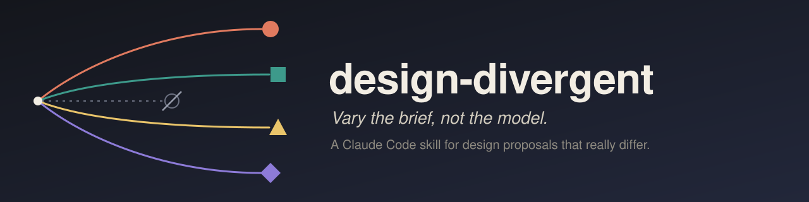
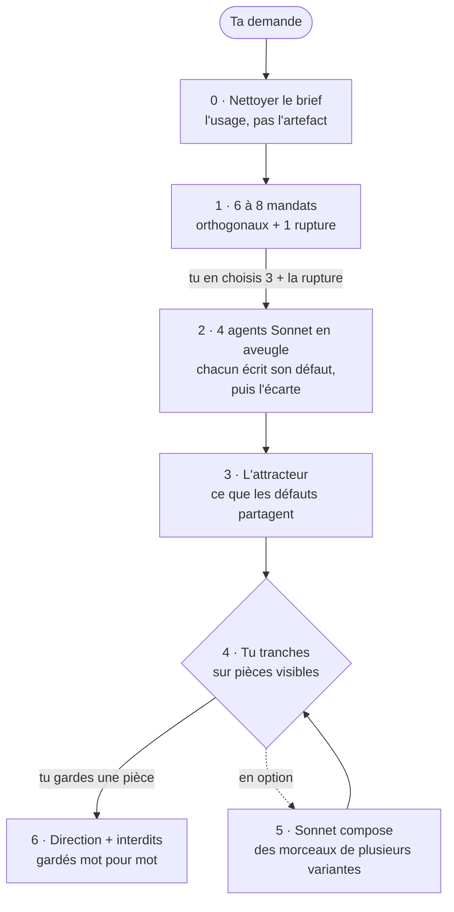

<p align="center">
  
</p>

<p align="center">
  <a href="LICENSE"></a>
  
  
  
</p>

<p align="center">
  <a href="#démarrage-rapide"><b>Démarrage rapide</b></a> ·
  <a href="#comment-ça-marche"><b>Comment ça marche</b></a> ·
  <a href="#documentation"><b>Documentation</b></a> ·
  <a href="https://github.com/amiel-35/ix-design-divergent/issues"><b>Signaler un problème</b></a> ·
  <a href="README.md"><b>English</b></a>
</p>

---

Demande un écran à trois modèles, tu as trois fois le même écran. Demande
« quelque chose d'audacieux », tu as le même écran avec un dégradé.

Le problème, ce n'est pas le modèle, c'est le brief. **design-divergent** est
un skill Claude Code qui travaille le brief, fait produire quatre agents en
aveugle, chacun contre son propre défaut, et te laisse trancher sur des pièces
que tu peux regarder.

## À quoi ça ressemble

Un run réel : l'écran au repos d'une tablette murale, lu à trois mètres dans
la pénombre. Avant de produire, chacun des huit agents a écrit l'écran qu'il
ferait par défaut. Puis il a eu interdiction de le faire.

| Les 8 défauts, écrits puis écartés | Les 8 variantes faites à la place |
|---|---|
| fond bleu nuit ou anthracite, **8 / 8** | un tableau des départs de gare |
| une rangée de cartes arrondies (météo, qui est là, demain), **8 / 8** | une une de quotidien |
| une grotesque géométrique (Inter, Manrope, Poppins…), **8 / 8** | presque rien, un point final comme seul signal |
| une grosse horloge au centre, **6 / 8** | une aiguille sur un cadran de bord |
| un bandeau rouge pleine largeur pour l'alerte, **4 / 8** | une affiche Bauhaus, aplats et diagonales |
| « interchangeable avec n'importe quel écran de domotique » (un agent, sur son propre défaut) | un mot écrit à la main sur le frigo |
| | une éphéméride |
| | lumière et matière, une fenêtre en arche sur le ciel |

Aucune variante n'a gardé les cartes. Et les huit, sans qu'on le leur
demande, ont confié l'état de la maison (alerte, à faire, tout va bien) à **un
seul objet qui change de nature** : un point, une aiguille, un aplat, une
étiquette. Ce genre de convergence imprévue entre des mandats différents,
c'est ce que le skill t'apprend à chercher : c'est en général l'élément le
plus propre à ton produit.

## Pourquoi ça marche

Cinq constats tirés de runs réels, détaillés dans [la méthode](docs/fr/methode.md) :

- **La variance vient du brief, pas du modèle.** Trois modèles, un brief : un
  écran. Un modèle, quatre briefs : quatre écrans.
- **Nommer un artefact, c'est déjà avoir décidé du design.** « Une rose des
  vents », c'est une réponse, pas un besoin.
- **Une référence citée devient une cible.** Une inspiration glissée en
  passant est traitée comme un cahier des charges.
- **Demander de l'audace ne produit rien.** Faire écrire au modèle son défaut,
  puis le lui interdire, si.
- **Des mandats orthogonaux, pas opposés.** « Fais l'inverse » fabrique un
  désaccord qui n'apprend rien.

## Comment ça marche



| Étape | Ce qui se passe | Qui décide |
|---|---|---|
| 0 · Nettoyer le brief | Écrit l'usage (« trois secondes et un pouce »), passe le test des noms pour retirer les décisions de design cachées, enlève les références qui seraient copiées, sépare les contraintes dures du goût. | Tu valides le brief nettoyé. |
| 1 · Mandats | Propose 6 à 8 partis pris esthétiques, jamais des objets à dessiner, plus une rupture qui casse la catégorie. | **Tu en choisis 3 + la rupture**, et tu donnes le feu vert sur le coût. |
| 2 · Produire en aveugle | Quatre agents Sonnet en parallèle, chacun avec son seul mandat, aucun ne voit les autres ni la version existante. | |
| 3 · Attracteur | Met les quatre défauts écartés côte à côte : à quoi ressemble le banal sur ce brief, et si une variante y est retombée. | |
| 4 · Trancher | Te montre les pièces et l'attracteur. Garder une pièce telle quelle, ou ta version de départ, est une issue valable. | **Toi.** |
| 5 · Composer | Seulement si tu le demandes : un agent Sonnet prend des morceaux à plusieurs variantes et dit ce qu'il refuse de prendre à chacune. | Toi encore. |
| 6 · Garder la trace | `direction.md`, et chaque refus dans les interdits, **mot pour mot**, pour le tour suivant. | |

## Démarrage rapide

```bash
git clone https://github.com/amiel-35/ix-design-divergent ~/.claude/skills/design-divergent
```

Relance Claude Code, puis :

- *« /design-divergent l'écran d'accueil de notre appli de facturation »*
- *« Ces trois propositions de landing page se ressemblent toutes, fais diverger. »*
- *« Propose-moi des pistes vraiment différentes pour ce générique de 20 secondes. »*

Pour mettre à jour : `git -C ~/.claude/skills/design-divergent pull`.

### Tes propres contraintes

Copie `local.example.md` en `local.md` dans le même dossier. Le skill le lit
en premier : mets-y ton design system (ce qui ne diverge jamais : palette,
typo, logo), les outils que tu ne veux jamais voir utilisés, ta langue et
l'endroit où garder le journal des runs. `local.md` est ignoré par git.

## Coût

Environ **12 minutes et 185 000 tokens par variante**, mesurés sur un run,
soit à peu près 750 000 tokens pour un tour complet de quatre. Le skill
l'annonce et attend ton feu vert avant de produire. Il est fait pour les
livrables qui comptent, pas pour une retouche.

## Documentation

| | Français | English |
|---|---|---|
| Dix constats, chacun avec le cas d'où il vient | [methode.md](docs/fr/methode.md) | [method.md](docs/en/method.md) |
| Les cinq runs réels, anonymisés | [cas.md](docs/fr/cas.md) | [cases.md](docs/en/cases.md) |
| Ce qu'on ne sait pas encore | [questions-ouvertes.md](docs/fr/questions-ouvertes.md) | [open-questions.md](docs/en/open-questions.md) |
| Le skill lui-même | | [SKILL.md](SKILL.md) |

## Limites

> [!WARNING]
> Cinq runs, une exécution par case. Ce sont des notes de terrain, pas un
> benchmark. Dans le test fondateur, deux variables changeaient à la fois, et
> l'étape de composition est devenue optionnelle après avoir été rejetée deux
> fois de suite. Tout est dans [questions-ouvertes.md](docs/fr/questions-ouvertes.md).
> Les runs qui contredisent tout ça sont bienvenus en issue.

## Projets frères

- [ghost-council](https://github.com/amiel-35/ghost-council) : des méthodes
  de philosophes en skills, et un conseil qui les fait délibérer.
- [ix-skills](https://github.com/amiel-35/ix-skills) : des postures de
  raisonnement. Son skill `explorer` utilise le même geste (« écris le
  défaut, puis écarte-le ») pour des options plutôt que des designs.

## Licence

[MIT](LICENSE).
