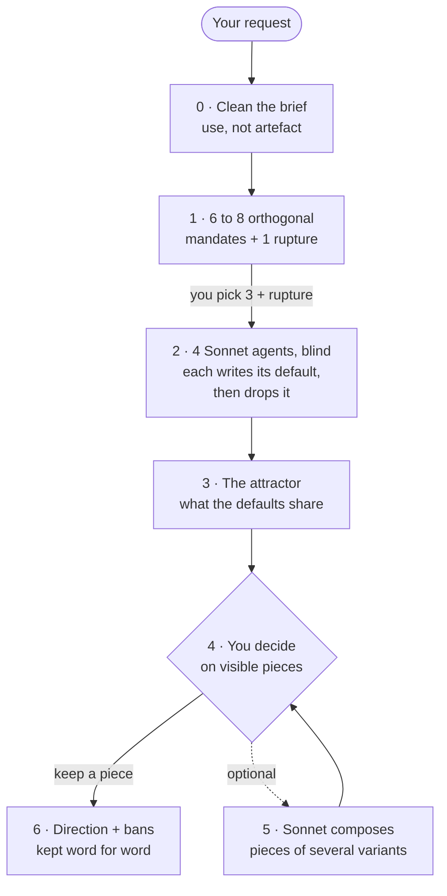

<p align="center">
  
</p>

<p align="center">
  <a href="LICENSE"></a>
  
  
  
</p>

<p align="center">
  <a href="#quick-start"><b>Quick start</b></a> ·
  <a href="#how-it-works"><b>How it works</b></a> ·
  <a href="#documentation"><b>Documentation</b></a> ·
  <a href="https://github.com/amiel-35/ix-design-divergent/issues"><b>Report an issue</b></a> ·
  <a href="README.fr.md"><b>Français</b></a>
</p>

---

Ask three models for a screen, you get the same screen three times. Ask for
"something bold", you get the same screen with a gradient.

The problem is not the model. It is the brief. **design-divergent** is a
Claude Code skill that works on the brief, has four agents produce blind,
each against its own default, and leaves the decision to you, on pieces you
can look at.

## What it looks like

A real run: the idle screen of a wall tablet, read from three metres away in
dim light. Before producing, each of the eight agents wrote the screen it
would make by default. Then it was forbidden to make it.

| The 8 defaults, written then discarded | The 8 variants made instead |
|---|---|
| navy or charcoal background, **8 / 8** | a station departures board |
| a row of rounded cards (weather, people, tomorrow), **8 / 8** | a newspaper front page |
| a geometric sans (Inter, Manrope, Poppins…), **8 / 8** | almost nothing, a full stop as the only signal |
| a big clock in the middle, **6 / 8** | a needle on a dashboard dial |
| a red full-width banner for alerts, **4 / 8** | a Bauhaus poster, flat colour and diagonals |
| "interchangeable with any home-automation screen" (an agent, about its own default) | a handwritten note on the fridge |
| | a tear-off calendar |
| | light and matter, an arched window on the sky |

No variant kept the cards. And all eight, without being asked, handed the
state of the house (alert, to do, all good) to **a single object that changes
nature**: a dot, a needle, a flat colour, a label. That kind of unplanned
convergence between different mandates is what the skill teaches you to look
for: it is usually the element most specific to your product.

## Why it works

Five findings from real runs, each detailed in [the method](docs/en/method.md):

- **Variance comes from the brief, not from the model.** Three models, one
  brief: one screen. One model, four briefs: four screens.
- **Naming an artefact means the design is already decided.** "A compass
  rose" is an answer, not a need.
- **A cited reference becomes a target.** Mention an inspiration in passing,
  it gets treated as a spec.
- **Asking for boldness produces nothing.** Making the model write its default,
  then forbidding it, does.
- **Mandates must be orthogonal, not opposite.** "Do the reverse" manufactures
  a disagreement that teaches nothing.

## How it works



| Step | What happens | Who decides |
|---|---|---|
| 0 · Clean the brief | Writes the use ("three seconds and a thumb"), runs a noun test to strip hidden design decisions, drops references that would be copied, separates hard constraints from taste. | You check the cleaned brief. |
| 1 · Mandates | Proposes 6 to 8 aesthetic stances, never objects to draw, plus one rupture that breaks the category. | **You pick 3 + the rupture**, and give the go-ahead on cost. |
| 2 · Produce blind | Four Sonnet agents in parallel, each with its own mandate only, none sees the others nor the existing version. | |
| 3 · Attractor | Puts the four discarded defaults side by side: what bland looks like on this brief, and whether a variant fell back into it. | |
| 4 · Decide | Shows you the pieces and the attractor. Keeping one piece as it is, or your original, is a valid outcome. | **You.** |
| 5 · Compose | Only if you ask: a Sonnet agent takes pieces from several variants and says what it refuses to take from each. | You again. |
| 6 · Keep the trail | `direction.md`, plus every rejection in `bans.md`, **word for word**, for the next round. | |

## Quick start

```bash
git clone https://github.com/amiel-35/ix-design-divergent ~/.claude/skills/design-divergent
```

Restart Claude Code, then:

- *"/design-divergent the onboarding screen of our invoicing app"*
- *"These three landing page proposals all look alike, make it diverge."*
- *"Give me really different directions for this 20-second motion intro."*

To update: `git -C ~/.claude/skills/design-divergent pull`.

### Your own constraints

Copy `local.example.md` to `local.md` in the same folder. The skill reads it
first: put there your design system (what may never diverge: palette, type,
logo), the tools you never want used, your language and where to log runs.
`local.md` is ignored by git.

## Cost

About **12 minutes and 185,000 tokens per variant**, measured on one run, so
roughly 750,000 tokens for a full round of four. The skill announces it and
waits for your go-ahead before producing. It is made for deliverables that
matter, not for a touch-up.

## Documentation

| | English | Français |
|---|---|---|
| Ten findings, each with the case it comes from | [method.md](docs/en/method.md) | [methode.md](docs/fr/methode.md) |
| The five real runs, anonymised | [cases.md](docs/en/cases.md) | [cas.md](docs/fr/cas.md) |
| What we do not know yet | [open-questions.md](docs/en/open-questions.md) | [questions-ouvertes.md](docs/fr/questions-ouvertes.md) |
| The skill itself | [SKILL.md](SKILL.md) | |

## Limits

> [!WARNING]
> Five runs, one execution per cell. The findings are field notes, not a
> benchmark. In the founding test two variables changed at once, and the
> composition step was made optional after the user rejected it twice in a row.
> All of it is in [open-questions.md](docs/en/open-questions.md). Runs that
> contradict it are welcome as issues.

## Sibling projects

- [ghost-council](https://github.com/amiel-35/ghost-council): philosophers'
  methods as skills, and a council that makes them deliberate.
- [ix-skills](https://github.com/amiel-35/ix-skills): reasoning postures.
  Its `explorer` skill uses the same "write the default, then drop it" move
  for options instead of designs.

## License

[MIT](LICENSE).
